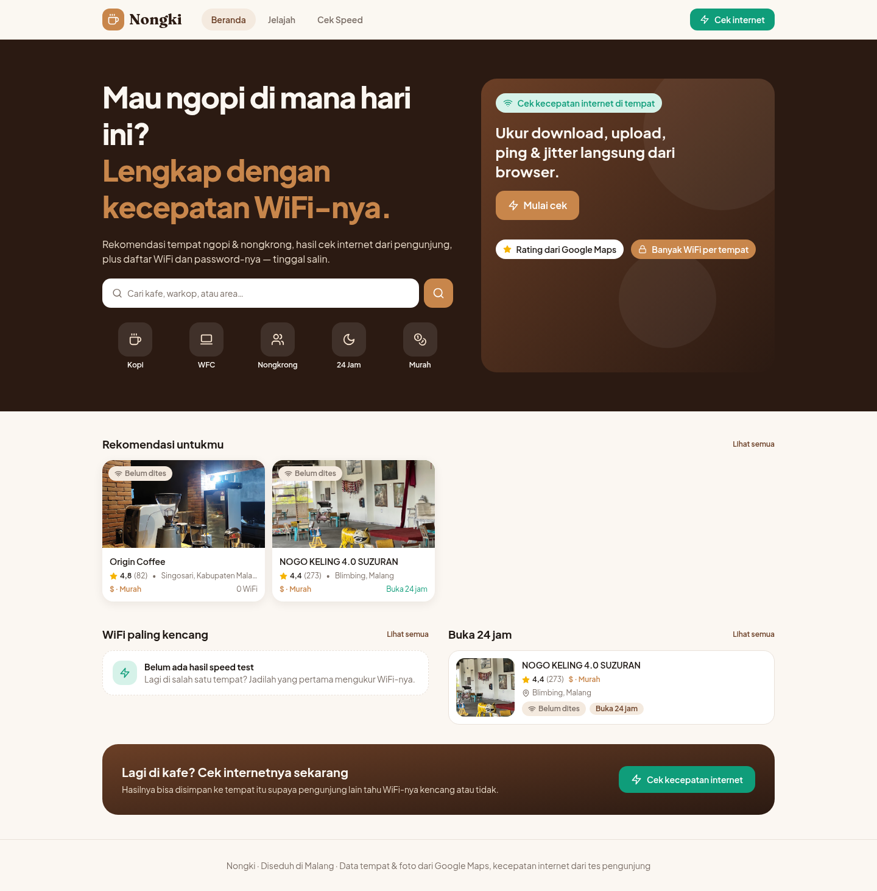
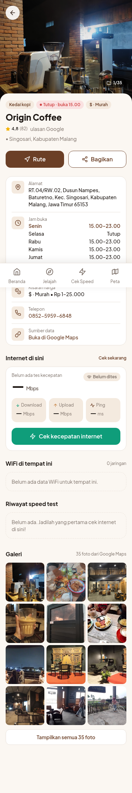
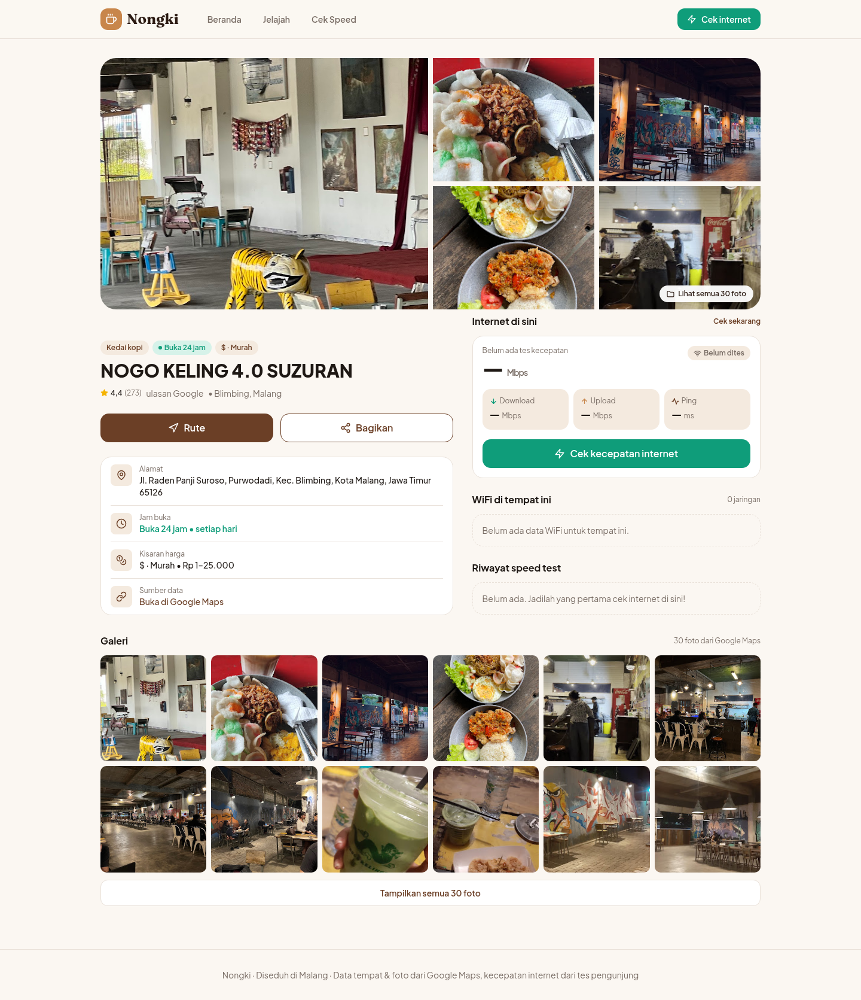
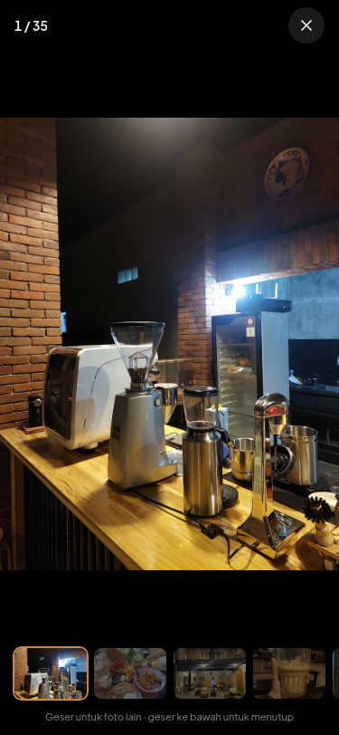
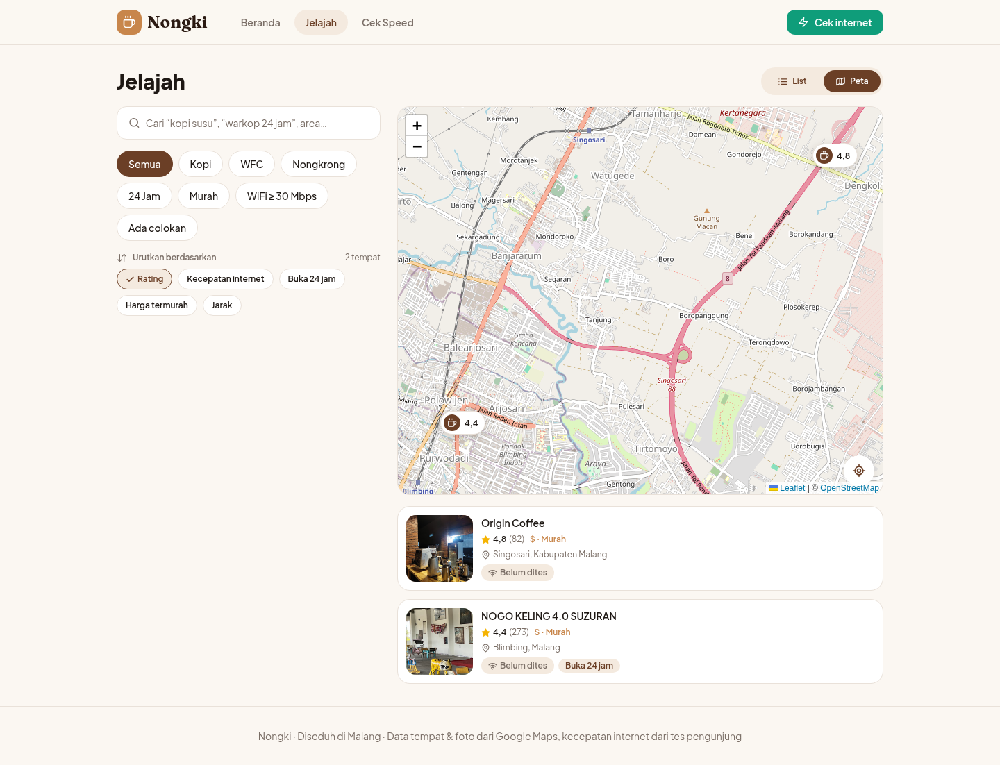
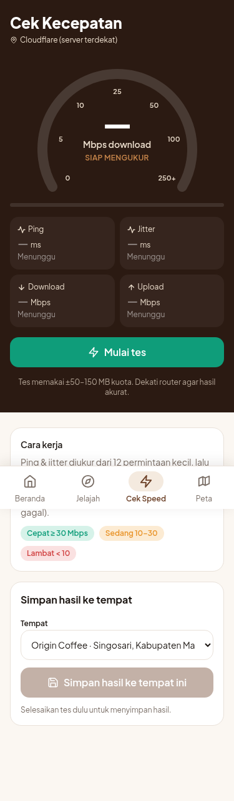
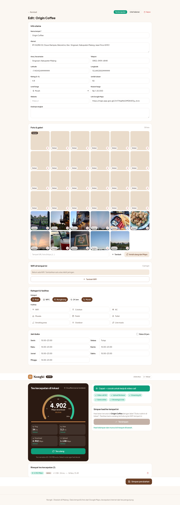

# ☕ Nongki — Rekomendasi tempat ngopi & nongkrong + cek WiFi

Nongki adalah web app untuk mencari tempat ngopi/nongkrong (fokus Malang) lengkap dengan **galeri foto dari Google Maps**, **daftar WiFi + password**, dan **tes kecepatan internet langsung dari browser** yang hasilnya tersimpan per tempat.

- 🌐 Produksi: **https://nongki-malang.vercel.app**
- 🔐 Admin: **https://nongki-malang.vercel.app/admin**
- 🎨 Desain Figma: https://www.figma.com/design/yb6hbJMBb4KYaQDQLsAGiD

> _English summary: Nongki is a Next.js app for discovering coffee shops. Admins add a place by pasting a Google Maps link (name, address, rating, hours, photos are scraped automatically), manage multiple WiFi networks per place, and run in-browser speed tests whose results drive a Fast/Medium/Slow badge. Data is stored as a JSON document in a private Vercel Blob store._

---

## Daftar isi

1. [Fitur](#fitur)
2. [Screenshot](#screenshot)
3. [Tech stack](#tech-stack)
4. [Arsitektur & penyimpanan data](#arsitektur--penyimpanan-data)
5. [Environment variables](#environment-variables)
6. [Menjalankan di lokal](#menjalankan-di-lokal)
7. [Deploy ke Vercel](#deploy-ke-vercel)
8. [Panduan admin](#panduan-admin)
9. [Cara kerja tes kecepatan](#cara-kerja-tes-kecepatan)
10. [API routes](#api-routes)
11. [Struktur folder](#struktur-folder)
12. [Keterbatasan](#keterbatasan)

---

## Fitur

### Untuk pengunjung
| Halaman | Isi |
|---|---|
| **Beranda** (`/`) | Pencarian, kategori (Kopi, WFC, Nongkrong, 24 Jam, Murah), rekomendasi, "WiFi paling kencang", "Buka 24 jam". |
| **Jelajah** (`/jelajah`) | Cari, filter kategori / WiFi ≥ 30 Mbps / ada colokan, urutkan (rating, kecepatan internet, buka 24 jam, harga termurah, jarak), tampilan **List** atau **Peta** (Leaflet + OpenStreetMap, tombol lokasi saya). State filter tersimpan di URL. |
| **Detail tempat** (`/tempat/[slug]`) | Galeri foto (carousel geser di HP, grid 1+4 di desktop, lightbox dengan swipe & keyboard), status **buka/tutup sekarang**, alamat, jam buka (hari ini disorot), harga, telepon, tombol **Rute** (Google Maps) & **Bagikan** (Web Share API, fallback salin link), fasilitas, ringkasan internet, **semua WiFi** (salin SSID, tampil/sembunyi & salin password), riwayat speed test. |
| **Cek Speed** (`/cek-speed`) | Tes ping, jitter, download, upload dengan gauge; hasil bisa disimpan ke tempat + WiFi yang dipakai. |

Badge kecepatan (rata-rata 5 tes terakhir): **Cepat ≥ 30 Mbps**, **Sedang 10–30 Mbps**, **Lambat < 10 Mbps**.

### Untuk admin (`/admin`)
- Login dengan password (`ADMIN_PASSWORD`), sesi berupa cookie **httpOnly** bertanda tangan HMAC (7 hari), percobaan login dibatasi 8×/10 menit per IP.
- **Tambah tempat cukup dengan link Google Maps** (link pendek `maps.app.goo.gl/…` atau link penuh) → data terisi otomatis → admin bisa melengkapi sebelum simpan.
- **Galeri**: semua foto yang bisa diambil dari Maps (biasanya 20–40+), duplikat dibuang otomatis. Admin bisa menghapus foto, memilih sampul, menambah URL foto sendiri, atau **"Ambil ulang dari Maps"**.
- **Banyak WiFi per tempat** (SSID, password, catatan/lokasi mis. "lantai 2").
- Kategori, fasilitas, jam buka, harga, koordinat, dll.
- **Tes kecepatan langsung dari halaman admin** per tempat; hasil diberi label _"Diukur admin di lokasi"_, langsung masuk riwayat & memengaruhi badge.
- Hapus tempat dan hapus hasil tes yang keliru.

---

## Screenshot

| HP (375 px) | Desktop (1440 px) |
|---|---|
|  |  |
|  |  |
|  |  |
|  |  |

---

## Tech stack

- **Next.js 16 (App Router)** + **React 19**, TypeScript, server components + route handlers
- **Tailwind CSS v4** (token warna dari desain Figma: espresso, caramel, cream, mint)
- Font **Plus Jakarta Sans** (teks) & **Fraunces** (logo/angka display) via `next/font`
- **Leaflet** + **react-leaflet** + tile **OpenStreetMap** (tanpa API key)
- **@vercel/blob** (private store) sebagai penyimpanan data
- Tes kecepatan: endpoint publik **Cloudflare speed** (`speed.cloudflare.com/__down` & `__up`) dengan fallback ke API sendiri
- Hosting: **Vercel** (auto-deploy dari branch `main`)

---

## Arsitektur & penyimpanan data

```
Browser ──► Next.js (Vercel Functions)
              ├─ halaman (server components, dynamic)
              ├─ /api/admin/*  (dicek cookie admin)
              ├─ /api/speed/*  (ping/down/up/results)
              └─ lib/db.ts ──► Vercel Blob (private): nongki/db.json
                               └─ fallback lokal: .data/db.json
```

- Seluruh data ada di **satu dokumen JSON** (`nongki/db.json`) di **Vercel Blob privat**:
  ```ts
  { version: 2, places: Place[], speeds: SpeedResult[] }
  ```
  - `Place`: nama, slug, alamat, area, lat/lng, rating, ulasan, harga, jam buka, kategori, fasilitas, `photos[]` (galeri; `photoUrl` = sampul), `wifi[]` ({ id, ssid, password, note }), link Maps.
  - `SpeedResult`: placeId, wifiId (opsional), down/up (Mbps), ping/jitter (ms), server, `by` (`admin` | `pengunjung`), waktu.
- Tulis data memakai pola read-modify-write yang diserialkan per instance (`mutateDB`). Cukup untuk trafik kecil; lihat [Keterbatasan](#keterbatasan).
- Tanpa `BLOB_READ_WRITE_TOKEN`, data disimpan ke `.data/db.json` (otomatis dibuat, di-ignore git).
- **Tidak ada data contoh/seed**: database baru selalu kosong, isi lewat admin.
- Kenapa bukan Postgres? Saat proyek dibuat, provisioning Neon/Upstash lewat Marketplace butuh persetujuan manual di dashboard; Blob bisa dibuat & disambungkan langsung. Mengganti `lib/db.ts` ke Postgres/Redis cukup mengubah `loadDB`/`saveDB`.

### Import dari Google Maps (`lib/maps.ts`)
1. Ikuti redirect link pendek (maks. 8 hop) → URL `google.com/maps/...`.
2. Baca nama/koordinat dari URL (`/place/…`, `!3d!4d`, `@lat,lng`, `q=`), ambil `ftid`.
3. Buka halaman Maps, cari URL internal `maps/preview/place?...pb=...`, ambil JSON-nya (prefix `)]}'` dibuang).
4. Ekstrak: nama, alamat, koordinat, rating, jumlah ulasan, kategori Google, jam buka per hari, telepon, website, kisaran harga.
5. **Foto**: kumpulkan semua URL `lh*.googleusercontent.com` dari bagian sampul, galeri kategori, dan foto ulasan tempat itu saja; tiap foto diunduh sebagai thumbnail 24×24 lalu di-hash (SHA-1) untuk membuang duplikat; maks. 48 foto.
6. Kategori Nongki ditebak dari kategori Google, jam 24 jam, dan level harga.

---

## Environment variables

| Nama | Wajib | Keterangan |
|---|---|---|
| `ADMIN_PASSWORD` | ✅ | Password login `/admin`. Gunakan string acak panjang. |
| `SESSION_SECRET` | disarankan | Kunci HMAC cookie sesi. Jika kosong memakai `ADMIN_PASSWORD`. Mengganti nilainya = semua sesi admin logout. |
| `BLOB_READ_WRITE_TOKEN` | produksi | Dibuat otomatis oleh Vercel saat Blob store disambungkan ke project. Tanpa ini → file lokal. |

Contoh ada di [`.env.example`](.env.example). **Jangan pernah commit nilai aslinya.**

---

## Menjalankan di lokal

Butuh Node.js 20+ (disarankan 22).

```bash
git clone https://github.com/podsni/nongki.git
cd nongki
npm install
cp .env.example .env.local      # isi ADMIN_PASSWORD (dan SESSION_SECRET)
npm run dev                     # http://localhost:3000
```

- Tanpa `BLOB_READ_WRITE_TOKEN` data tersimpan di `.data/db.json`.
- Untuk memakai Blob produksi dari lokal: `vercel env pull .env.local` (hati-hati, ini data asli).
- Build produksi: `npm run build && npm start`. Lint: `npm run lint`.

---

## Deploy ke Vercel

1. Push repo ke GitHub, lalu **Import Project** di Vercel (framework: Next.js, tanpa setting tambahan).
2. **Storage → Create → Blob**, pilih akses **Private**, region dekat pengguna (mis. `sin1`), lalu **Connect** ke project → `BLOB_READ_WRITE_TOKEN` terisi otomatis.
3. **Settings → Environment Variables**: tambahkan `ADMIN_PASSWORD` dan `SESSION_SECRET` (tipe _Sensitive_, Production + Preview).
4. Deploy. Setiap push ke `main` otomatis deploy ke produksi.
5. (Opsional) **Settings → Domains** untuk domain publik. Domain `*-<team>.vercel.app` bawaan bisa terkena _Deployment Protection_; domain produksi tambahan (mis. `nongki-malang.vercel.app`) bisa diakses publik.
6. (Opsional) **Settings → Functions → Region** ke `sin1` agar lebih cepat dari Indonesia.

---

## Panduan admin

### Masuk
Buka `/admin`, masukkan password. Tombol **Keluar** ada di kanan atas.

### Menambah tempat dari Google Maps
1. Di aplikasi Google Maps: buka tempatnya → **Bagikan** → **Salin link** (`https://maps.app.goo.gl/...`).
2. Admin → **Tambah dari Google Maps** → tempel link → **Ambil data**.
3. Kotak hijau menampilkan data apa saja yang berhasil diambil (mis. `nama · alamat · koordinat · rating · jam buka · 35 foto · harga`) dan peringatan jika ada.
4. Lengkapi: **WiFi**, **fasilitas**, kategori, deskripsi. Cek galeri, pilih sampul, hapus foto yang tidak relevan.
5. **Simpan tempat** → diarahkan ke halaman edit.

> Tip: kalau link tidak terbaca, pakai link dari tombol **Bagikan** di app Maps (link pendek berisi `ftid`). Bisa juga **Isi manual tanpa link**.

### Mengelola galeri
- **Ambil ulang dari Maps** — mengambil foto terbaru dari link Maps tempat itu (foto manual tetap disimpan). Klik **Simpan perubahan** setelahnya.
- **Sampul** — jadikan foto sebagai sampul (foto pertama).
- **×** — hapus foto. **Tambah** — tempel URL foto `https://` sendiri.

### Banyak WiFi dalam satu tempat
Di kartu **WiFi di tempat ini** klik **Tambah WiFi** sebanyak yang perlu. Isi:
- **Nama WiFi (SSID)** — wajib,
- **Password** — kosongkan jika WiFi terbuka,
- **Catatan / lokasi** — mis. "lantai 2", "area outdoor", "khusus pelanggan".

Baris tanpa SSID diabaikan saat simpan. Maksimal 30 WiFi per tempat.

### Tes kecepatan dari admin
1. Datang ke lokasi dan sambungkan HP/laptop ke WiFi tempat itu.
2. Admin → tombol **Tes speed** pada kartu tempat (atau **Tes kecepatan** di halaman edit).
3. **Mulai tes** (±20 detik). Pilih WiFi yang dipakai pada "Diukur di WiFi mana?".
4. **Simpan hasil ke tempat ini** → hasil langsung muncul di riwayat (label _Admin_) dan badge tempat diperbarui.
5. Hasil yang salah bisa dihapus dari **Riwayat tes kecepatan** (ikon tempat sampah).

> Penting: ukur hanya saat benar-benar tersambung ke WiFi tempat tersebut. Tes dari rumah/kantor/data seluler akan membuat badge menyesatkan.

---

## Cara kerja tes kecepatan

Semua berjalan di browser pengunjung (`components/SpeedTest.tsx`):

| Tahap | Metode |
|---|---|
| Ping & jitter | 12 request kecil berurutan (1 pemanasan dibuang). Ping = median, jitter = rata-rata selisih antar ping. |
| Download | 4 koneksi paralel selama ±8 detik, 1,2 detik pertama dibuang (slow-start). |
| Upload | 3 koneksi paralel `XMLHttpRequest` (progress upload) selama ±7 detik. |
| Server | Cloudflare (server terdekat, CORS terbuka); jika gagal otomatis pindah ke `/api/speed/*` milik Nongki. |

Satu tes memakai sekitar 50–150 MB kuota (tergantung kecepatan).

---

## API routes

| Method & path | Auth | Fungsi |
|---|---|---|
| `GET /api/places` | publik | Daftar tempat + rata-rata kecepatan (tanpa detail password WiFi, hanya jumlah). |
| `GET /api/speed/ping` | publik | Respons kecil untuk ukur ping. |
| `GET /api/speed/down?bytes=N` | publik | Stream data acak (maks. 25 MB). |
| `POST /api/speed/up` | publik | Menerima & menghitung byte upload, balas `{ bytes, ms }`. |
| `POST /api/speed/results` | publik (6×/10 mnt/IP) | Simpan hasil tes pengunjung `{ placeId, wifiId?, down, up, ping, jitter, server }`. |
| `POST /api/admin/login` | — | `{ password }` → set cookie sesi. |
| `POST /api/admin/logout` | admin | Hapus cookie. |
| `POST /api/admin/import` | admin | `{ url }` → draft data dari Google Maps (termasuk `photos[]`, `extracted[]`, `warnings[]`). |
| `POST /api/admin/places` | admin | Buat tempat. |
| `PUT /api/admin/places/:id` | admin | Ubah tempat (termasuk `wifi[]`, `photos[]`). |
| `DELETE /api/admin/places/:id` | admin | Hapus tempat + riwayat tesnya. |
| `POST /api/admin/speeds` | admin | Simpan hasil tes admin (label "Diukur admin"). |
| `DELETE /api/admin/speeds/:id` | admin | Hapus satu hasil tes. |

Contoh:
```bash
curl -c jar -X POST https://nongki-malang.vercel.app/api/admin/login \
  -H 'content-type: application/json' -d '{"password":"…"}'
curl -b jar -X POST https://nongki-malang.vercel.app/api/admin/import \
  -H 'content-type: application/json' -d '{"url":"https://maps.app.goo.gl/…"}'
```

---

## Struktur folder

```
app/
  page.tsx                 Beranda
  jelajah/                 List + peta
  tempat/[slug]/           Detail tempat
  cek-speed/               Tes kecepatan publik
  admin/                   Login, daftar, tambah (import), edit + speedtest
  api/                     Route handlers (lihat tabel API)
components/
  Gallery.tsx              Hero galeri, grid, lightbox (swipe/keyboard)
  SpeedTest.tsx            Tes kecepatan (mode publik & admin)
  Explorer.tsx, MapView.tsx  Jelajah + peta Leaflet
  PlaceClient.tsx          Bagikan, daftar WiFi (salin/tampil password)
  admin/                   LoginForm, ImportFlow, PlaceForm (WiFi & foto editor)
lib/
  db.ts                    Baca/tulis JSON (Blob / file lokal) + migrasi ringan
  places.ts                CRUD tempat & hasil tes, validasi input
  maps.ts                  Import Google Maps (data + galeri foto)
  auth.ts, guard.ts        Sesi admin (HMAC cookie)
  util.ts                  Format, level kecepatan, status buka, ukuran foto
  types.ts, form.ts        Tipe data & konversi form
```

---

## Keterbatasan

- **Import Google Maps memakai scraping** data internal halaman Maps (tidak resmi). Bisa berhenti bekerja jika Google mengubah format atau memblokir IP server; data yang gagal diambil tetap bisa diisi manual.
- **Foto di-hotlink** dari `googleusercontent.com` (tidak disalin ke storage sendiri). Jika Google menghapus/mengganti foto, gambar bisa hilang → gunakan **Ambil ulang dari Maps**.
- **Password WiFi tampil publik** di halaman detail (memang tujuan fitur salin password). Jangan simpan password yang tidak boleh diketahui umum.
- **Penyimpanan satu file JSON** di Blob: dua penulisan yang benar-benar bersamaan dari instance berbeda bisa saling menimpa. Cukup untuk skala kecil; pindah ke Postgres untuk skala besar.
- **Hasil tes pengunjung tidak diverifikasi** (hanya dibatasi per IP). Admin dapat menghapus hasil yang janggal; hasil admin diberi label.
- Akurasi tes bergantung pada browser & perangkat; fallback server Nongki (Vercel) kurang akurat dibanding Cloudflare.
- Tile peta OpenStreetMap tunduk pada kebijakan fair-use OSM.
